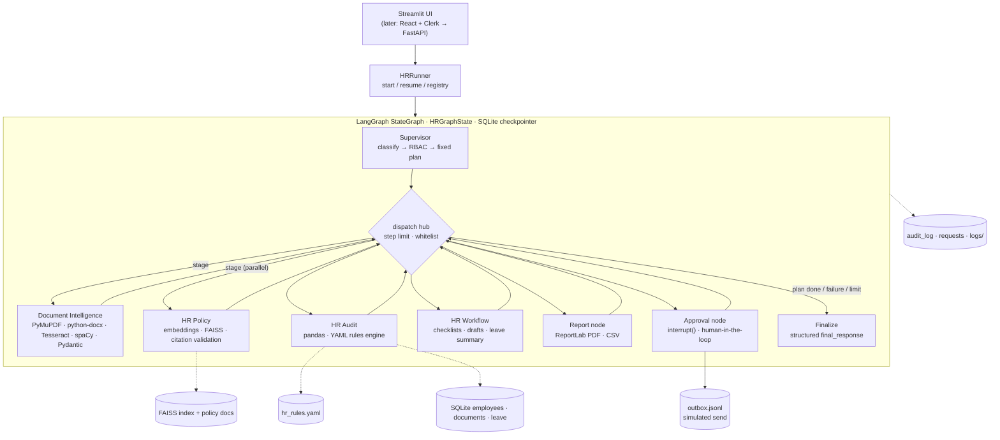

## Architecture

### Workflows (fixed plans — the Supervisor can only pick a task type, never invent a path)

| Workflow | Task type | Stages (`‖` = parallel) |
|---|---|---|
| A. Policy question | `policy_question` | policy |
| B. Document audit | `document_audit` | document_intelligence → audit → report |
| C. Onboarding automation | `onboarding` | (document_intelligence ‖ policy) → audit → workflow → report → **approval** |
| D. Audit summary | `audit_summary` | audit → workflow → report |
| Leave / pending tasks | `leave_summary` | workflow |

### Design decisions

* **Hub-and-spoke control.** Every agent returns to `dispatch`; there is no agent-to-agent messaging. Plans are a constant table (`WORKFLOWS`) and the dispatcher whitelists node names.
* **Compliance is code, not LLM.** `RulesEngine` (YAML-configured rule *instances*, Python rule *types*) decides every finding and classifies it `confirmed_violation` vs `potential_discrepancy`. The LLM only writes a narrative, from IDs/rule codes, and cannot alter findings.
* **Graceful degradation.** With no LLM configured, classification falls back to keyword rules, policy answers become extractive (still citation-validated), and summaries use templates. Every LLM output is validated (closed enum for routing; `[S#]` citations + number grounding for policy).
* **Reducers.** List fields in `HRGraphState` use keyed-merge reducers (`finding_id`, `draft_id`, …) so retries and resumes are idempotent.
* **Retry/fallback & limits.** `guarded()` retries each agent once, then records `failed` and the supervisor stops with a `partial` result; `max_steps` bounds the loop; LangGraph `recursion_limit` is a second guard.
* **Human approval.** The approval node calls `interrupt()`; the checkpoint (SQLite) survives restarts. Only `hr_manager`/`admin` decisions are honoured; approved drafts go to a simulated outbox — no SMTP exists in the prototype.
* **Privacy.** State holds IDs, ISO dates and masked values; drafts hold a `{first_name}` placeholder and a masked recipient, resolved from the DB only when an approved email is queued. HR document extraction (onboarding/audit uploads) is LLM-free. The one exception is employee proof-of-work files: their text is injection-stripped, wrapped as untrusted data and summarised by an LLM into an unverified, human-reviewable note - the summary can trigger no action.
* **Observability.** Python logging (`logs/hr360.log`), per-agent timing/attempt status in state, SQLite `audit_log` for agent runs and approvals, and optional LangSmith (set `LANGSMITH_TRACING=true` + `LANGSMITH_API_KEY`).

### Swapping pieces later

| Now | Later |
|---|---|
| SQLite (`HRDatabase`) | PostgreSQL — change the connection factory in `data/db.py` |
| `SqliteSaver` | `PostgresSaver` in `graph/builder.make_checkpointer` |
| Streamlit | React/shadcn + Clerk → FastAPI endpoints wrapping `HRRunner.run/resume/get` |
| Simulated outbox | SMTP/Graph API call inside `graph/nodes._queue_email` (post-approval only) |

### Work tracking (stand-ups, projects, contribution evidence)

`Work Insights Agent` (graph node `work_insights`, task types `project_status` / `person_record`) plus a REST API (`/api/work/*`).
* **Data:** `projects`, `project_members`, `milestones`, `standups` (one row per person/project/day), `evidence` (proof files + AI summary + human review status), `github_identities`, `github_events`. Own `WORK_METADATA`, so re-seeding employees never wipes history.
* **Deterministic analytics** (`hr360/work/analytics.py`): milestone progress vs. timeline, open-blocker age, quiet members (leave-aware), stand-up consistency, repeated-plan detection, GitHub activity counts, stand-up/GitHub mismatch. The LLM only narrates.
* **Deliberately absent:** composite scores, leaderboards, rankings, "worst performer" answers (the Supervisor routes those to `unsupported`), lines-of-code as a metric (shown as raw context only). Members are always listed alphabetically.
* **Access:** employees see/enter their own data; PMs see projects they manage; HR sees everything; every per-person view is audit-logged; proof files must be confirmed by a manager/HR (authors cannot review their own).
* **GitHub:** `POST /api/work/github/events` + identity mapping is the integration point; a GitHub Action or webhook can post the same payload later.
