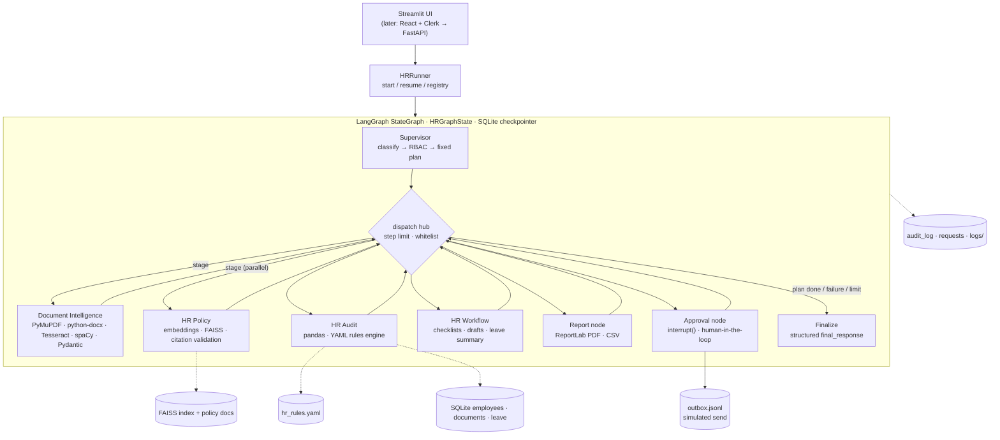

## Architecture

### Workflows (fixed plans — the Supervisor can only pick a task type, never invent a path)

| Workflow | Task type | Stages (`‖` = parallel) |
|---|---|---|
| A. Policy question | `policy_question` | policy |
| B. Document audit | `document_audit` | document_intelligence → audit → report |
| C. Onboarding automation | `onboarding` | (document_intelligence ‖ policy) → audit → workflow → report → **approval** |
| D. Audit summary | `audit_summary` | audit → workflow → report |
| Leave / pending tasks | `leave_summary` | workflow |

### Design decisions

* **Hub-and-spoke control.** Every agent returns to `dispatch`; there is no agent-to-agent messaging. Plans are a constant table (`WORKFLOWS`) and the dispatcher whitelists node names.
* **Compliance is code, not LLM.** `RulesEngine` (YAML-configured rule *instances*, Python rule *types*) decides every finding and classifies it `confirmed_violation` vs `potential_discrepancy`. The LLM only writes a narrative, from IDs/rule codes, and cannot alter findings.
* **Graceful degradation.** With no LLM configured, classification falls back to keyword rules, policy answers become extractive (still citation-validated), and summaries use templates. Every LLM output is validated (closed enum for routing; `[S#]` citations + number grounding for policy).
* **Reducers.** List fields in `HRGraphState` use keyed-merge reducers (`finding_id`, `draft_id`, …) so retries and resumes are idempotent.
* **Retry/fallback & limits.** `guarded()` retries each agent once, then records `failed` and the supervisor stops with a `partial` result; `max_steps` bounds the loop; LangGraph `recursion_limit` is a second guard.
* **Human approval.** The approval node calls `interrupt()`; the checkpoint (SQLite) survives restarts. Only `hr_manager`/`admin` decisions are honoured; approved drafts go to a simulated outbox — no SMTP exists in the prototype.
* **Privacy.** State holds IDs, ISO dates and masked values; drafts hold a `{first_name}` placeholder and a masked recipient, resolved from the DB only when an approved email is queued. Uploaded document text never reaches an LLM.
* **Observability.** Python logging (`logs/hr360.log`), per-agent timing/attempt status in state, SQLite `audit_log` for agent runs and approvals, and optional LangSmith (set `LANGSMITH_TRACING=true` + `LANGSMITH_API_KEY`).

### Swapping pieces later

| Now | Later |
|---|---|
| SQLite (`HRDatabase`) | PostgreSQL — change the connection factory in `data/db.py` |
| `SqliteSaver` | `PostgresSaver` in `graph/builder.make_checkpointer` |
| Streamlit | React/shadcn + Clerk → FastAPI endpoints wrapping `HRRunner.run/resume/get` |
| Simulated outbox | SMTP/Graph API call inside `graph/nodes._queue_email` (post-approval only) |
